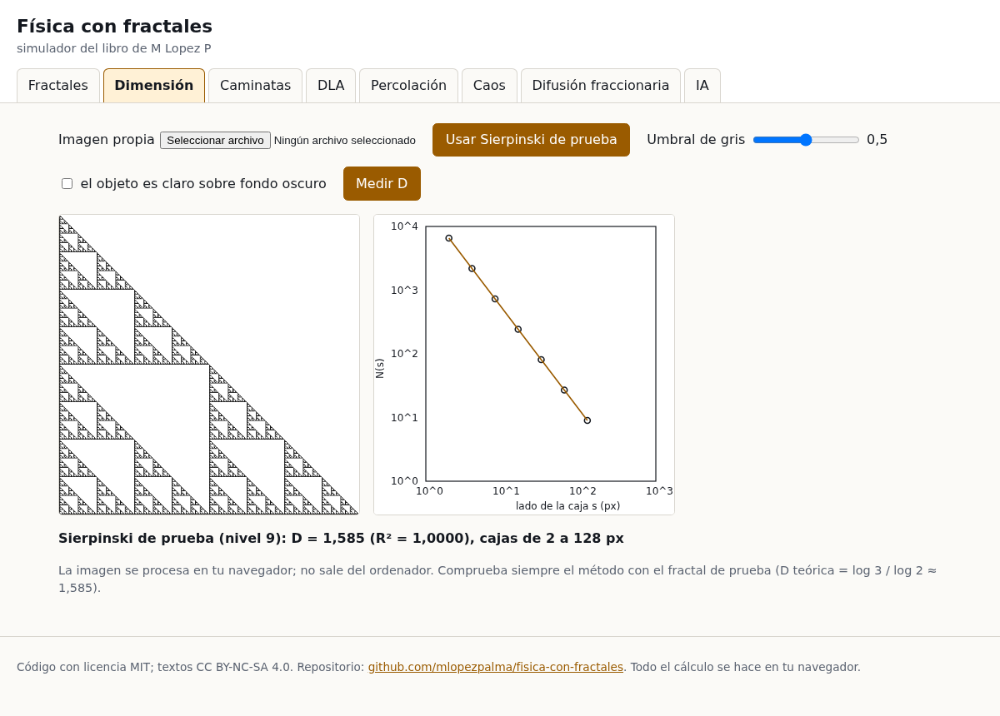
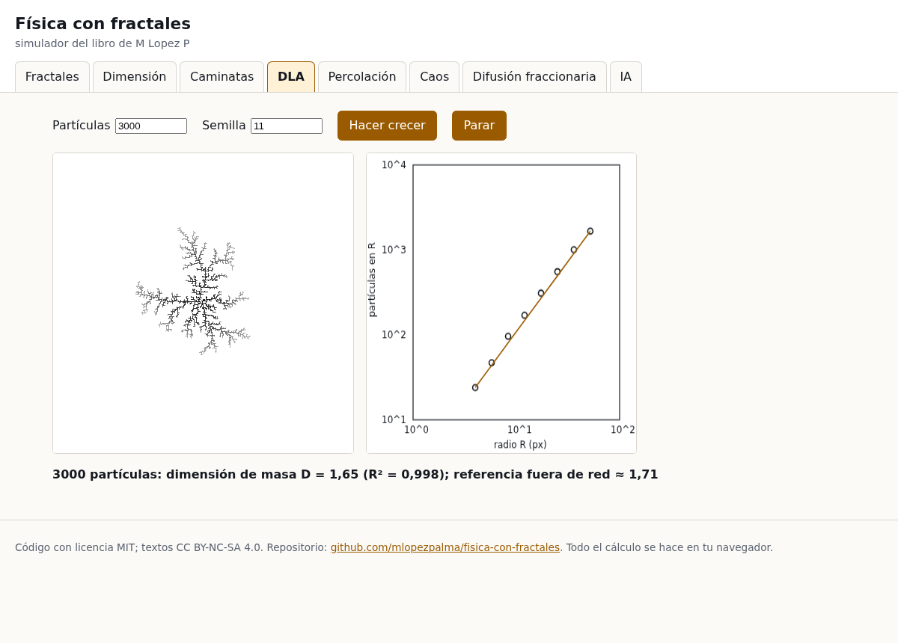
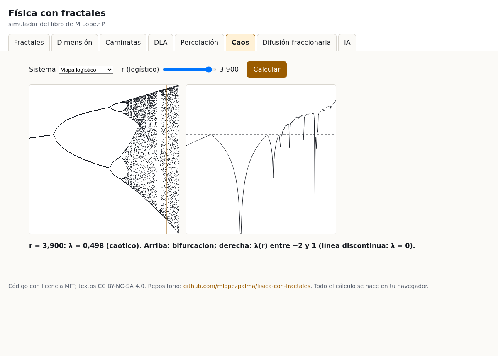
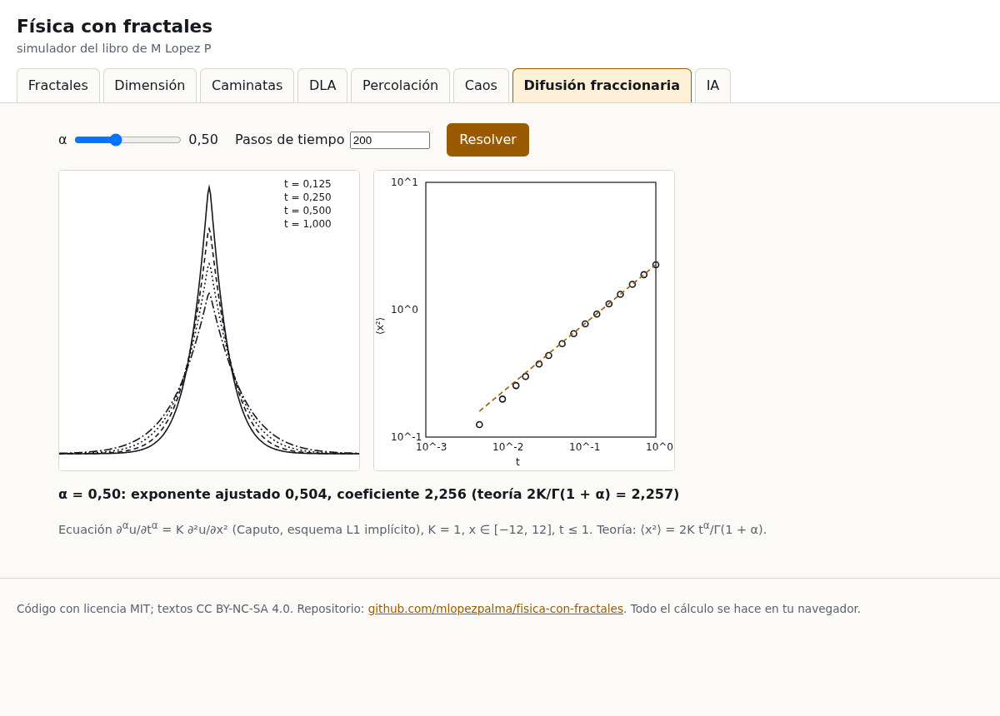

# Física con fractales — simulador y aplicación

Materiales del libro *Física con fractales. Cómo plantear y resolver ecuaciones físicas con dimensión fractal, caos, difusión anómala y cálculo fraccionario, con simulador en Python, aplicación web y ayuda de la IA*, de **M Lopez P** (noviembre de 2026).

Dos herramientas que hacen lo mismo de dos formas:

- **Aplicación web** (carpeta [`docs/`](docs/index.html)): funciona en el navegador sin instalar nada. Publicada con GitHub Pages en https://mlopezpalma.github.io/fisica-con-fractales/ o, sin conexión, abriendo `docs/index.html`.
- **Paquete de Python** `fractales_fisica`: calcula todas las cifras y figuras del libro, con pruebas.

## La aplicación









Pestañas: fractales clásicos (Cantor, Koch, Sierpinski, Mandelbrot, Julia), dimensión por conteo de cajas de una imagen propia, caminatas aleatorias y vuelos de Lévy, DLA, percolación, caos (logístico y Lorenz), difusión fraccionaria e IA. Más capturas en la carpeta `docs/capturas/`. Se puede enlazar directamente una pestaña: `index.html#dla`, `#percolacion`, `#caos`…

Todo el cálculo se hace en el navegador. Las imágenes que se cargan no salen del ordenador.

## El paquete de Python

```bash
git clone https://github.com/mlopezpalma/fisica-con-fractales
cd fisica-con-fractales
python -m venv .venv && source .venv/bin/activate
pip install -e ".[figuras,ia,pruebas]"      # solo NumPy es obligatorio
```

```bash
python -m fractales_fisica koch --nivel 6
python -m fractales_fisica imagen hoja.png --umbral 0.5
python -m fractales_fisica feigenbaum
python -m fractales_fisica lorenz --tiempo 500
python -m fractales_fisica difusion --alfa 0.6 --ia
python -m fractales_fisica hurst ejemplos/serie-fgn-h07.csv
python -m fractales_fisica verificar feigenbaum_delta 4.67
python -m fractales_fisica figuras --carpeta figuras     # las 22 figuras del libro
pytest                                                   # pruebas de Python y de la aplicación (Node, si está)
```

| Módulo | Capítulo del libro |
|---|---|
| `dimension`, `conjuntos` | 1–3: dimensión fractal, leyes de escala, conjuntos clásicos |
| `aleatorio` | 4–5: movimiento browniano, difusión anómala, vuelos de Lévy, fBm |
| `dla` | 6: agregación limitada por difusión |
| `percolacion` | 7: percolación y exponentes críticos |
| `caos` | 8–9: mapa logístico, Feigenbaum, Lyapunov, Lorenz |
| `turbulencia` | 10: espectro de Kolmogorov y cascada multifractal |
| `fraccionario` | 11: derivadas de Caputo y Grünwald-Letnikov, Mittag-Leffler, difusión fraccionaria |
| `porosos` | 12: Darcy, permeabilidad de redes porosas, rugosidad |
| `antenas` | 13: geometría de antenas fractales |
| `biologia` | 14: red vascular y ley de Kleiber, costas |
| `series` | 15: exponente de Hurst (R/S y DFA) |
| `ia` | 16: asistente de IA opcional |
| `libro`, `figuras` | todas las cifras y figuras del libro |

Todas las cifras del libro salen de `fractales_fisica.libro.calcular()` con semillas fijas; en otro ordenador deben dar lo mismo. Si no, abre una incidencia o mira [ERRATAS.md](ERRATAS.md).

## IA: cómo funciona y dónde va la clave

El módulo de IA es **opcional** y explica un resultado o revisa una derivación con el modelo `claude-sonnet-5-5` de la API de Anthropic. **Nunca calcula**: recibe los números del simulador y tiene instrucciones de no inventar otros. Las cifras que proponga se comprueban con `python -m fractales_fisica verificar …`.

- **Python**: la clave se lee **solo** de la variable de entorno `ANTHROPIC_API_KEY` (`export ANTHROPIC_API_KEY="tu-clave"`). El paquete no la escribe en ningún archivo ni la imprime.
- **Aplicación web**: se pega en un campo de contraseña; se queda en la memoria de la página (no en `localStorage`, cookies ni archivos) y solo se envía a `https://api.anthropic.com`. La política de seguridad de la página (`Content-Security-Policy`) impide conectarse a cualquier otra dirección.
- **Sin clave**: las dos funcionan en **modo sin clave**, con una explicación local por plantillas y la lista de comprobaciones.
- **Nunca subas una clave al repositorio.** `.gitignore` excluye `.env` y `*.key`.

Las instrucciones (prompts) del capítulo 16 están en [`prompts/`](prompts/README.md).

## Programas que ya existen

Si necesitas algo más completo que este paquete didáctico: `nolds` (Hurst, DFA, Lyapunov), `MFDFA`, `andi-datasets` (trayectorias con verdad conocida), `PoreSpy` (medios porosos), `differint` (cálculo fraccionario), FracLac (ImageJ), Gwyddion (superficies). La lista con licencias está en las referencias del libro.

## Licencias

- Código (`fractales_fisica/`, `tests/`, archivos `.js`, `.css` y `.html` de `docs/`): **MIT**, ver [LICENSE](LICENSE).
- Textos (este README, `prompts/`, `ERRATAS.md`, textos de la aplicación): **CC BY-NC-SA 4.0**, ver [LICENSE-TEXTO.md](LICENSE-TEXTO.md).

Este repositorio se preparó con ayuda de herramientas de inteligencia artificial y se revisó con pruebas automáticas; los errores que queden son responsabilidad del autor.
